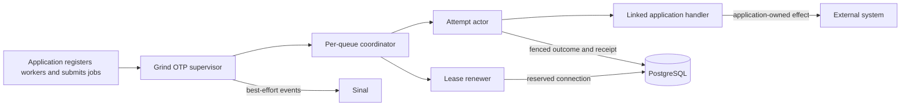

# Grind

[](https://github.com/gleam-dream/grind/actions/workflows/ci.yml)
[](https://hex.pm/packages/grind)
[](https://gleam.run/)

Grind is a durable background-job runtime for Gleam applications on Erlang/OTP and PostgreSQL. It retains typed job outcomes in PostgreSQL and runs handlers under OTP supervision.

Use Grind for work that must outlive its request in an Erlang/OTP and PostgreSQL application: notifications, provider callbacks, and delayed or retryable tasks. Jobs can be admitted in the same database transaction as an application write. Operators can recover work when an external effect is uncertain.

Grind is a fit for durable individual jobs with local per-node queue limits. It does not currently provide cron schedules, durable dependency workflows, batch coordination, or cluster-wide rate limits.

## Capabilities

- Define workers with typed input, output, and optional error values, explicit JSON codecs, and versioned stored contracts.
- Submit jobs immediately or for a scheduled time; use stable submission IDs and recover an ambiguous admission with its pending command.
- Configure scoped uniqueness, retries, snoozes, handler timeouts, and what happens after an abandoned attempt.
- Run named queues under OTP supervision with per-node concurrency, database leases, and independent lease renewal.
- Read typed job state and outcomes; list jobs, inspect queue statistics, quarantine expired attempts, and prune finished jobs in bounded batches.
- Observe typed lifecycle events and runtime diagnostics through Sinal. Events are best-effort; durable rows are the source of job outcomes.
- Submit in the caller's open `READ COMMITTED` transaction, or let Grind own admission's transaction.
- Apply Grind migrations at startup or as a deployment step, with one migration owner for each schema.

## Install

Add Grind from Hex:

```sh
gleam add grind
```

The example below uses these direct dependencies. Commit `gleam.toml` and
`manifest.toml` to retain the resolved versions.

```toml
[dependencies]
grind = ">= 0.1.0 and < 0.2.0"
gleam_stdlib = ">= 0.70.0 and < 2.0.0"
gleam_erlang = ">= 1.0.0 and < 2.0.0"
gleam_otp = ">= 1.0.0 and < 2.0.0"
gleam_json = ">= 3.1.0 and < 4.0.0"
gleam_time = ">= 1.0.0 and < 2.0.0"
exception = ">= 2.1.1 and < 3.0.0"
pog = ">= 4.1.0 and < 4.2.0"
```

The Erlang target requires Gleam 1.18 or later and PostgreSQL. The repository's development shell uses OTP 29 and PostgreSQL 16.

## Quick start

Define a worker, add Grind to the application's supervision tree, and submit through its registered name. This example uses application-owned `Email` values and simulates delivery by returning a message ID. The application supervisor owns startup, restart, and shutdown.

<!-- prettier-ignore-start -->

<!-- snips: test/grind/facade/readme_test.gleam#quick-start -->
```gleam
import gleam/dynamic/decode
import gleam/erlang/process
import gleam/json
import gleam/otp/static_supervisor as supervisor
import gleam/time/duration
import grind
import grind/job
import grind/worker
import pog

pub type Email {
  Email(to: String, subject: String)
}

fn encode_email(email: Email) -> json.Json {
  json.object([
    #("to", json.string(email.to)),
    #("subject", json.string(email.subject)),
  ])
}

fn email_decoder() -> decode.Decoder(Email) {
  use to <- decode.field("to", decode.string)
  use subject <- decode.field("subject", decode.string)
  decode.success(Email(to:, subject:))
}

pub fn mailer() -> worker.Worker(Email, String, Nil) {
  worker.new(
    "mailer.send",
    input: worker.codec(worker.infallible(encode_email), email_decoder()),
    output: worker.codec(worker.infallible(json.string), decode.string),
    perform: fn(email) { Ok("msg:" <> email.to) },
  )
  |> worker.with_queue("mailers")
}

pub fn children(pool: pog.Config, name: process.Name(grind.Message)) {
  let config =
    grind.new(pool)
    |> grind.with_worker(mailer())
    |> grind.with_startup_migration
  supervisor.new(supervisor.OneForOne)
  |> supervisor.add(grind.supervised(config, name))
}

pub fn send(name: process.Name(grind.Message), email: Email) {
  let jobs = grind.named(name)
  let assert Ok(admission) = grind.submit(jobs, job.new(mailer(), email))
  grind.await(jobs, grind.handle(admission), within: duration.seconds(5))
}

```

<!-- prettier-ignore-end -->

The example opts into startup migration. In production, give DDL permission to the runtime only when that is your migration plan; otherwise call `grind.migrate` in a deployment step or use your migration tool. Choose one migration owner per schema.

## How the runtime fits together

Each configured worker has typed codecs and a stable identity. The runtime starts a coordinator for each used queue; a coordinator claims work into local capacity and starts one temporary attempt actor per handler invocation. Each attempt is fenced by its lease and identity. A separate renewer uses a reserved database connection so ordinary pool saturation does not also stop lease renewal.



Queue concurrency is local to each node. Budget one dedicated renewal connection per used queue in addition to the main pool. The application owns external effects; a committed job outcome records Grind's view of the handler result, not an atomic transaction with a provider.

## Enqueue with an application write

`grind.submit_in` stages admission in the caller's open `READ COMMITTED` transaction on the same database. The job commits or rolls back with the application write. Its reply is staged admission, not proof that the outer transaction committed.

<!-- prettier-ignore-start -->

<!-- snips: examples/usage/src/grind_usage/transactions.gleam#transaction -->
```gleam
let order = support.unique("order")
let assert Ok(grind.Inserted(handle)) =
  pog.transaction(db, fn(tx) {
    let assert Ok(_) =
      pog.query("INSERT INTO usage_orders (id) VALUES ($1)")
      |> pog.parameter(pog.text(order))
      |> pog.execute(tx)
    grind.submit_in(jobs, tx, job.new(receipt, 9) |> job.with_id(order))
  })
```

<!-- prettier-ignore-end -->

The [runnable transaction example](examples/usage/src/grind_usage/transactions.gleam) also shows rollback behavior.

## Recovery and operating limits

- A lost admission reply can return `CommitUnknown(pending)`. Retain that pending command and call `grind.reconcile_submission`; a missing receipt is still unknown. Reuse the same command identity when retrying.
- External effects are not exactly-once: submission receipts deduplicate the admission command, not a provider call. Use a provider-enforced idempotency key or an application ledger when effects must not repeat.
- An abandoned attempt is `Uncertain` by default because its external effect may have happened. Investigate the provider or business ledger before confirming the outcome or authorizing replay. Resolution attribution does not enforce operator permissions.
- Cancellation is cooperative intent. It cannot retract an effect or promise that the handler did no work.
- `await` may return `Pending`; it does not cancel the job. Its final storage read can exceed the requested wait, and queued database checkout can exceed the storage-call deadline.
- Receipts are pruned with finished jobs. For deduplication or audit history that must outlive job retention, keep an application-owned business record.

## Learn more

- [Compiled usage examples](examples/usage/README.md) cover workers, jobs, transactions, handlers, runtime configuration, uniqueness, recovery, retention, and migrations.
- [Public consumer guide](consumer/README.md) exercises the API from a separate package.
- [Design and operating contracts](docs/design/design-layer.pdf) document defaults and the detailed boundaries.
- [Benchmark method and retained results](docs/BENCHMARKS.md) include historical measurements and their limits.
